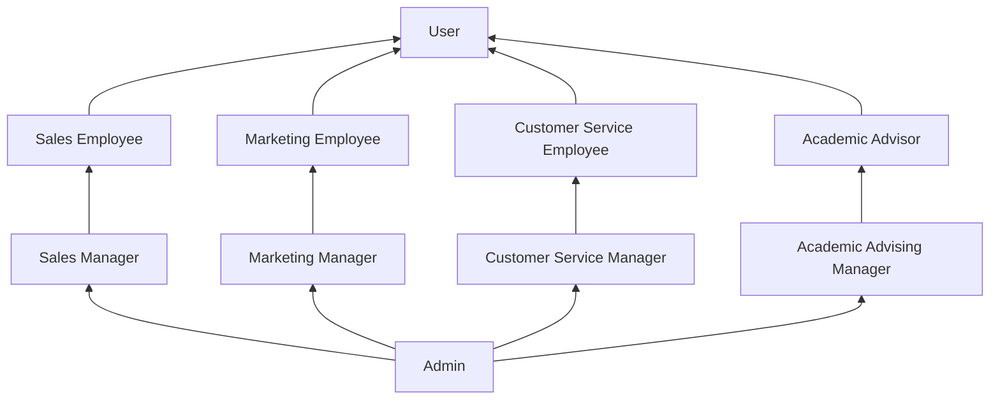
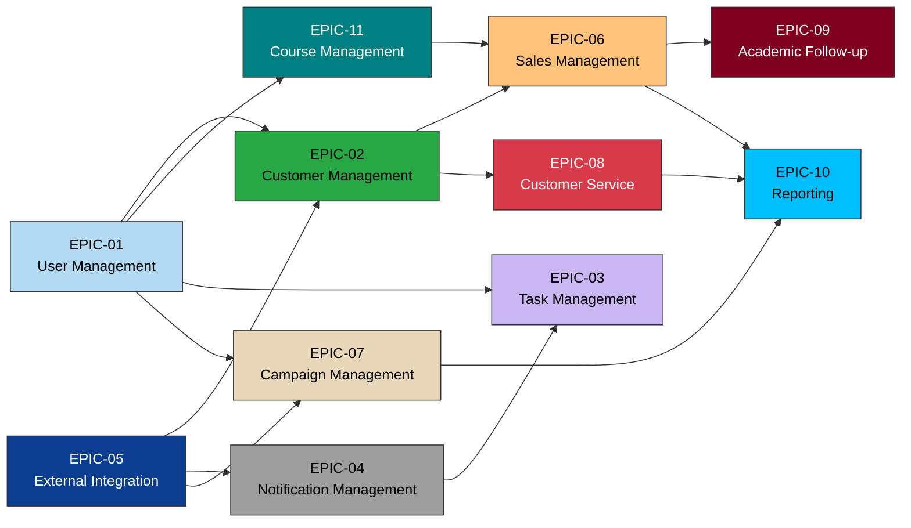

# CRM — Product Backlog: Epics & User Stories

> Structured product backlog for the CRM platform, prepared for **GitHub** documentation and **Jira** task assignment. It is derived from the CRM use case diagrams and is organized into **11 Epics** and **72 User Stories**, each with a priority, dependencies, and acceptance criteria.

          

## Table of Contents

- [Project Overview](#project-overview)
- [Conventions](#conventions)
- [Roles and Access Model](#roles-and-access-model)
- [Epic Overview](#epic-overview)
- [Epics and User Stories](#epics-and-user-stories)
  - [EPIC-01 · User Management](#epic-01--user-management)
  - [EPIC-02 · Customer Management](#epic-02--customer-management)
  - [EPIC-03 · Task Management](#epic-03--task-management)
  - [EPIC-04 · Notification Management](#epic-04--notification-management)
  - [EPIC-05 · External Integration](#epic-05--external-integration)
  - [EPIC-06 · Sales Management](#epic-06--sales-management)
  - [EPIC-07 · Campaign Management](#epic-07--campaign-management)
  - [EPIC-08 · Customer Service](#epic-08--customer-service)
  - [EPIC-09 · Academic Follow-up](#epic-09--academic-follow-up)
  - [EPIC-10 · Reporting](#epic-10--reporting)
  - [EPIC-11 · Course Management](#epic-11--course-management)
- [Delivery Roadmap and Jira Assignment Order](#delivery-roadmap-and-jira-assignment-order)

## Project Overview

The CRM supports an education-oriented organization that converts leads into subscribed students. It covers lead capture and distribution, payment and subscription, academic follow-up of subscribed students, marketing campaigns, customer service ticketing, task and notification management, and management reporting.

**Key business rules captured in this backlog**

1. A customer must have the status **Subscribed** (set by the sales team) before an academic advisor can place the student in a group.
2. Subscribing a customer to a course transfers the customer's data to the academic team automatically, with no re-entry.
3. Users are **frozen or deactivated, never deleted**, so that linked customer records remain intact.
4. Logging a contact documents communication that already happened; the system does not contact customers by itself.
5. Marketing employees see customers only within a limited scope (source and status).
6. The Academic Follow-up module is a stated priority of the business owner.

## Conventions

### Identifiers

| Item | Format | Example |
|---|---|---|
| Epic | `EPIC-NN` | `EPIC-06` |
| User Story | `<EPIC-PREFIX>-NN` | `SL-03` |

Story IDs are permanent identifiers: they are not renumbered or reused when stories are added or retired.

### Story format

> As a **\<role\>**, I want to **\<capability\>**, so that **\<benefit\>**.

### Priority scale (aligned with Jira defaults)

| Priority | Meaning |
|---|---|
| ⏫ **Highest** | Mandatory for the first usable release, a blocker for other work, or a business-owner priority. |
| 🔼 **High** | Core functionality required for the system to deliver its main value. |
| ▶️ **Medium** | Important functionality that can follow the core flow. |
| 🔽 **Low** | Useful enhancement with limited impact if postponed. |
| ⏬ **Lowest** | Optional; not part of the confirmed requirements. |

### Epic color legend

| Epic | Color | Hex |
|---|---|---|
|  | Light Blue | `#B3DAF2` |
|  | Green | `#28A745` |
|  | Light Purple | `#C9B6F2` |
|  | Gray | `#9E9E9E` |
|  | Dark Blue | `#0B3D91` |
|  | Light Orange | `#FFC27A` |
|  | Beige (Sugar) | `#E8D8B9` |
|  | Red | `#D73A49` |
|  | Burgundy | `#800020` |
|  | Sky Blue | `#00BFFF` |
|  | Teal | `#008080` |

## Roles and Access Model

Every employee role inherits from **User**; every manager inherits from the employee role of the same department; **Admin** inherits from all managers and therefore from all roles.

| Role | Inherits from | Directly owned capabilities (Epic) |
|---|---|---|
| User | — | Login, logout, password, notifications, own tasks (EPIC-01, 03, 04) |
| Sales Employee | User | Customers, payment and subscription (EPIC-02, 06) |
| Marketing Employee | User | Limited customer view, view campaigns (EPIC-02, 07) |
| Customer Service Employee | User | Customer file, tickets, subscribed students (EPIC-02, 08, 09) |
| Academic Advisor | User | Subscribed students, placement, student file (EPIC-09) |
| Sales Manager | Sales Employee | Distribution, assignment, import, tasks, sales reports (EPIC-03, 05, 06, 10) |
| Marketing Manager | Marketing Employee | Campaign management, tasks, marketing reports (EPIC-03, 07, 10) |
| Customer Service Manager | Customer Service Employee | All tickets, escalations, tasks, service reports (EPIC-03, 08, 10) |
| Academic Advising Manager | Academic Advisor | Inherits academic capabilities (EPIC-09) |
| Admin | All managers | User and role administration, consolidated dashboard (EPIC-01, 10) |

## Epic Overview

| Epic | Color | Priority | Stories | Key Actors |
|---|---|---|---|---|
|  | `#B3DAF2` | ⏫ Highest | 11 | User, Admin |
|  | `#28A745` | ⏫ Highest | 12 | Sales Employee, Customer Service Employee, Marketing Employee |
|  | `#C9B6F2` | ▶️ Medium | 6 | User, Task Manager (Sales / Marketing / Customer Service Manager) |
|  | `#9E9E9E` | 🔼 High | 3 | User, Notification Service, Scheduler |
|  | `#0B3D91` | 🔼 High | 5 | Sales Manager, Scheduler, Google Sheets, WhatsApp |
|  | `#FFC27A` | ⏫ Highest | 7 | Sales Employee, Sales Manager |
|  | `#E8D8B9` | 🔼 High | 6 | Marketing Employee, Marketing Manager, Google Sheets |
|  | `#D73A49` | 🔼 High | 9 | Customer Service Employee, Customer Service Manager |
|  | `#800020` | ⏫ Highest | 3 | Academic Advisor, Academic Advising Manager |
|  | `#00BFFF` | ▶️ Medium | 6 | Sales Manager, Marketing Manager, Customer Service Manager, Admin |
|  | `#008080` | 🔼 High | 4 | Admin, Sales Manager |

### Epic flow

Arrows show the recommended build order (the target Epic builds on the source Epic).

## Epics and User Stories

### EPIC-01 · User Management

Authentication, account lifecycle, and role-based access control for every CRM user. Accounts are frozen rather than deleted so that customer records linked to a user are preserved.

| Attribute | Value |
|---|---|
| **Epic key** | `EPIC-01` |
| **Color** | Light Blue (`#B3DAF2`) |
| **GitHub label** | `epic:user-management` |
| **Epic priority** | ⏫ Highest |
| **Actors** | User, Admin |
| **Stories** | 11 |

| ID | Title | Actor | Priority | Depends on |
|---|---|---|---|---|
| **UM-01** | Log in | User | ⏫ Highest | — |
| **UM-02** | Log out | User | 🔼 High | UM-01 |
| **UM-03** | Change own password | User | ▶️ Medium | UM-01 |
| **UM-04** | View users list | Admin | 🔼 High | UM-01, UM-10 |
| **UM-05** | Add user | Admin | ⏫ Highest | UM-06, UM-10 |
| **UM-06** | Assign role and permissions | Admin | ⏫ Highest | UM-10 |
| **UM-07** | Edit user data | Admin | 🔼 High | UM-05 |
| **UM-08** | Freeze / deactivate user | Admin | 🔼 High | UM-05 |
| **UM-09** | Reset user password | Admin | 🔼 High | UM-05 |
| **UM-10** | Define role permissions | Admin | ⏫ Highest | UM-01 |
| **UM-11** | View user details | Admin | 🔼 High | UM-04 |

<b>Story details and acceptance criteria — EPIC-01</b>

#### UM-01 — Log in

> As a **User**, I want to log in with my credentials, so that I can securely access the features permitted for my role.

- **Priority:** ⏫ Highest &nbsp;|&nbsp; **Depends on:** —
- **Acceptance criteria:**
  - [ ] Valid credentials grant access limited to the features permitted for the user's role.
  - [ ] Invalid credentials are rejected with a generic error that does not reveal which field was incorrect.
  - [ ] Frozen or deactivated accounts cannot log in.

#### UM-02 — Log out

> As a **User**, I want to log out of the system, so that my session is terminated and my account is protected.

- **Priority:** 🔼 High &nbsp;|&nbsp; **Depends on:** UM-01
- **Acceptance criteria:**
  - [ ] The session is terminated immediately on logout.
  - [ ] Protected pages are inaccessible after logout until the user signs in again.

#### UM-03 — Change own password

> As a **User**, I want to change my password, so that I can keep my account secure.

- **Priority:** ▶️ Medium &nbsp;|&nbsp; **Depends on:** UM-01
- **Acceptance criteria:**
  - [ ] The current password must be provided to set a new one.
  - [ ] The new password must satisfy the defined password policy.
  - [ ] A confirmation is displayed once the password has been updated.

#### UM-04 — View users list

> As an **Admin**, I want to view the list of all users, so that I can monitor and manage system accounts.

- **Priority:** 🔼 High &nbsp;|&nbsp; **Depends on:** UM-01, UM-10
- **Acceptance criteria:**
  - [ ] The list displays each user's name, role, and account status.
  - [ ] The list is accessible to Admin only.

#### UM-05 — Add user

> As an **Admin**, I want to add a new user, so that new staff members can access the system with the correct role.

- **Priority:** ⏫ Highest &nbsp;|&nbsp; **Depends on:** UM-06, UM-10
- **Note:** Includes UM-06.
- **Acceptance criteria:**
  - [ ] Required fields are validated before the account is created.
  - [ ] A role must be assigned during creation (see UM-06).
  - [ ] Duplicate accounts (same unique identifier) are rejected.

#### UM-06 — Assign role and permissions

> As an **Admin**, I want to assign a role and permissions to a user, so that each user receives only the access required for their job.

- **Priority:** ⏫ Highest &nbsp;|&nbsp; **Depends on:** UM-10
- **Note:** Included by UM-05; extends UM-07.
- **Acceptance criteria:**
  - [ ] The role is selected from the predefined role list.
  - [ ] The user's effective permissions follow those configured for the selected role (UM-10).
  - [ ] Assignment is mandatory when adding a user and optional when editing one.

#### UM-07 — Edit user data

> As an **Admin**, I want to edit an existing user's data, so that account information stays accurate and up to date.

- **Priority:** 🔼 High &nbsp;|&nbsp; **Depends on:** UM-05
- **Acceptance criteria:**
  - [ ] Admin can update a user's profile data.
  - [ ] The role and permissions can optionally be changed during the edit (UM-06).
  - [ ] Changes are persisted and reflected immediately in the users list.

#### UM-08 — Freeze / deactivate user

> As an **Admin**, I want to freeze or deactivate a user account, so that access is revoked while the customer records linked to that user are preserved.

- **Priority:** 🔼 High &nbsp;|&nbsp; **Depends on:** UM-05
- **Note:** Design decision: freezing replaces deletion.
- **Acceptance criteria:**
  - [ ] A frozen user can no longer log in.
  - [ ] All customer records and history linked to the user remain intact.
  - [ ] User deletion is intentionally not available; freezing replaces it.

#### UM-09 — Reset user password

> As an **Admin**, I want to reset a user's password, so that users who are locked out can regain access.

- **Priority:** 🔼 High &nbsp;|&nbsp; **Depends on:** UM-05
- **Acceptance criteria:**
  - [ ] Admin can reset the password of any user account.
  - [ ] The previous password becomes invalid immediately after the reset.

#### UM-10 — Define role permissions

> As an **Admin**, I want to define the permissions of each role, so that access control matches the organization's responsibilities.

- **Priority:** ⏫ Highest &nbsp;|&nbsp; **Depends on:** UM-01
- **Acceptance criteria:**
  - [ ] Admin can view and modify the permission set of each role.
  - [ ] Changes apply to every user holding that role.
  - [ ] Role inheritance is respected (see the Roles section).

#### UM-11 — View user details

> As an **Admin**, I want to view the details of a specific user, so that I can review an account's data, role, and status before managing it.

- **Priority:** 🔼 High &nbsp;|&nbsp; **Depends on:** UM-04
- **Acceptance criteria:**
  - [ ] The details display the user's profile data, assigned role and permissions, and account status.
  - [ ] The details are opened from the users list (UM-04).
  - [ ] The details are accessible to Admin only.

### EPIC-02 · Customer Management

The customer lifecycle from first contact to subscription: profile data, student–guardian linking, notes, contact logging, status changes, and the unified customer file with its journey timeline.

| Attribute | Value |
|---|---|
| **Epic key** | `EPIC-02` |
| **Color** | Green (`#28A745`) |
| **GitHub label** | `epic:customer-management` |
| **Epic priority** | ⏫ Highest |
| **Actors** | Sales Employee, Customer Service Employee, Marketing Employee |
| **Stories** | 12 |

| ID | Title | Actor | Priority | Depends on |
|---|---|---|---|---|
| **CM-01** | Add customer | Sales Employee | ⏫ Highest | UM-01 |
| **CM-02** | Add student | Sales Employee, Customer Service Employee | 🔼 High | CM-03 |
| **CM-03** | Edit customer data | Sales Employee, Customer Service Employee | 🔼 High | CM-01 |
| **CM-04** | Add note to customer | Sales Employee, Customer Service Employee | ▶️ Medium | CM-01 |
| **CM-05** | View and search customers | Sales Employee | ⏫ Highest | CM-01 |
| **CM-06** | View unified customer profile | Sales Employee, Customer Service Employee | 🔼 High | CM-01 |
| **CM-07** | View customer journey timeline | Sales Employee, Customer Service Employee | ▶️ Medium | CM-06 |
| **CM-08** | Change customer status | Sales Employee | ⏫ Highest | CM-01 |
| **CM-10** | Log customer contact | Sales Employee, Customer Service Employee | 🔼 High | CM-06 |
| **CM-11** | Limited customer view for marketing | Marketing Employee | ▶️ Medium | CM-05, UM-10 |
| **CM-12** | Edit customer note | Sales Employee, Customer Service Employee | ▶️ Medium | CM-04 |
| **CM-13** | Edit student data | Sales Employee, Customer Service Employee | 🔼 High | AF-03 |

<b>Story details and acceptance criteria — EPIC-02</b>

#### CM-01 — Add customer

> As a **Sales Employee**, I want to add a new customer at the time of first contact, so that every lead is captured in the CRM from the first interaction.

- **Priority:** ⏫ Highest &nbsp;|&nbsp; **Depends on:** UM-01
- **Acceptance criteria:**
  - [ ] Required customer fields are validated on save.
  - [ ] The customer source and the initial status are recorded.
  - [ ] The creating user and creation date are recorded.

#### CM-02 — Add student

> As a **Sales Employee or Customer Service Employee**, I want to add a student to a customer record, so that the student and the student's guardian are captured accurately.

- **Priority:** 🔼 High &nbsp;|&nbsp; **Depends on:** CM-03
- **Note:** Extends CM-03.
- **Acceptance criteria:**
  - [ ] A student can be added from the customer edit screen.
  - [ ] The student can be linked to a guardian record.
  - [ ] The student–guardian relationship is visible from both records.

#### CM-03 — Edit customer data

> As a **Sales Employee or Customer Service Employee**, I want to edit a customer's data, so that customer information remains accurate.

- **Priority:** 🔼 High &nbsp;|&nbsp; **Depends on:** CM-01
- **Note:** Extended by CM-02.
- **Acceptance criteria:**
  - [ ] Authorized users can update customer fields.
  - [ ] Updated values are immediately visible in the customer profile.

#### CM-04 — Add note to customer

> As a **Sales Employee or Customer Service Employee**, I want to add a note to a customer's file, so that important context is shared with colleagues.

- **Priority:** ▶️ Medium &nbsp;|&nbsp; **Depends on:** CM-01
- **Acceptance criteria:**
  - [ ] A note is saved with its author and timestamp.
  - [ ] Notes are displayed in the unified customer profile.

#### CM-05 — View and search customers

> As a **Sales Employee**, I want to view and search the customer list, so that I can quickly find the customers I work with.

- **Priority:** ⏫ Highest &nbsp;|&nbsp; **Depends on:** CM-01
- **Acceptance criteria:**
  - [ ] Customers can be searched by key attributes such as name, phone number, and status.
  - [ ] Results respect the user's role-based visibility.

#### CM-06 — View unified customer profile

> As a **Sales Employee or Customer Service Employee**, I want to view a unified file for each customer, so that I have the full context of the customer in one place.

- **Priority:** 🔼 High &nbsp;|&nbsp; **Depends on:** CM-01
- **Acceptance criteria:**
  - [ ] The profile consolidates customer data, notes, contact history, and current status.
  - [ ] The profile is the entry point to the journey timeline (CM-07).

#### CM-07 — View customer journey timeline

> As a **Sales Employee or Customer Service Employee**, I want to view a chronological timeline of the customer's journey, so that I can understand the customer's history at a glance.

- **Priority:** ▶️ Medium &nbsp;|&nbsp; **Depends on:** CM-06
- **Note:** Extends CM-06.
- **Acceptance criteria:**
  - [ ] Status changes, contacts, and notes are listed chronologically.
  - [ ] The timeline is accessible from the unified customer profile.

#### CM-08 — Change customer status

> As a **Sales Employee**, I want to change a customer's status, so that the customer's position in the lifecycle is always current.

- **Priority:** ⏫ Highest &nbsp;|&nbsp; **Depends on:** CM-01
- **Acceptance criteria:**
  - [ ] The status can be updated to any of the defined lifecycle stages.
  - [ ] Every change is recorded with the previous status, the new status, the user, and the date/time.
  - [ ] The status history is read-only.
  - [ ] The status Subscribed makes the customer eligible for academic placement (AF-02).

#### CM-10 — Log customer contact

> As a **Sales Employee or Customer Service Employee**, I want to log each contact held with a customer, so that all communication is documented in the customer file.

- **Priority:** 🔼 High &nbsp;|&nbsp; **Depends on:** CM-06
- **Acceptance criteria:**
  - [ ] The contact record captures the channel, date, and a summary.
  - [ ] The log documents communication that actually took place; the system does not contact customers on its own.

#### CM-11 — Limited customer view for marketing

> As a **Marketing Employee**, I want to view customers within my permitted scope, so that I can analyze lead sources without accessing sensitive data.

- **Priority:** ▶️ Medium &nbsp;|&nbsp; **Depends on:** CM-05, UM-10
- **Note:** Derived from a diagram note, not an explicit use case.
- **Acceptance criteria:**
  - [ ] Marketing employees see customers by source and status only.
  - [ ] Data beyond the permitted scope is hidden.

#### CM-12 — Edit customer note

> As a **Sales Employee or Customer Service Employee**, I want to edit a note on a customer's file, so that notes stay accurate and up to date.

- **Priority:** ▶️ Medium &nbsp;|&nbsp; **Depends on:** CM-04
- **Acceptance criteria:**
  - [ ] Authorized users can update the text of an existing note.
  - [ ] The original author and timestamp of the note are preserved.
  - [ ] The updated note is displayed in the unified customer profile.

#### CM-13 — Edit student data

> As a **Sales Employee or Customer Service Employee**, I want to edit a student's data, so that the student's information remains accurate.

- **Priority:** 🔼 High &nbsp;|&nbsp; **Depends on:** AF-03
- **Acceptance criteria:**
  - [ ] Authorized users can update the student fields.
  - [ ] The link to the student's guardian remains intact after the edit.
  - [ ] Updated values are immediately visible in the student file (AF-03).

### EPIC-03 · Task Management

Creation, assignment, and tracking of employee tasks. Managers create and edit tasks; every user can view their own tasks, open their details, and update their status. Task creation and edits notify the assignee.

| Attribute | Value |
|---|---|
| **Epic key** | `EPIC-03` |
| **Color** | Light Purple (`#C9B6F2`) |
| **GitHub label** | `epic:task-management` |
| **Epic priority** | ▶️ Medium |
| **Actors** | User, Task Manager (Sales / Marketing / Customer Service Manager) |
| **Stories** | 6 |

| ID | Title | Actor | Priority | Depends on |
|---|---|---|---|---|
| **TM-01** | View my tasks and department tasks | User | ▶️ Medium | UM-01 |
| **TM-02** | Change task status | User | ▶️ Medium | TM-01, TM-05 |
| **TM-03** | Add task | Task Manager | ▶️ Medium | UM-10, NT-02 |
| **TM-04** | Edit task | Task Manager | ▶️ Medium | TM-03, NT-02 |
| **TM-05** | View task details | User | ▶️ Medium | TM-01 |
| **TM-06** | Delete task | Task Manager | ▶️ Medium | TM-03 |

<b>Story details and acceptance criteria — EPIC-03</b>

#### TM-01 — View my tasks and department tasks

> As a **User**, I want to view the tasks assigned to me and, if I am a manager, the tasks of my department, so that I know what needs to be done.

- **Priority:** ▶️ Medium &nbsp;|&nbsp; **Depends on:** UM-01
- **Acceptance criteria:**
  - [ ] An employee sees only the tasks assigned to them.
  - [ ] A manager sees their own tasks and the tasks of the employees in their department.
  - [ ] Each task displays its title, details, and current status.

#### TM-02 — Change task status

> As a **User**, I want to update the status of my task, so that progress is transparent to my manager.

- **Priority:** ▶️ Medium &nbsp;|&nbsp; **Depends on:** TM-01, TM-05
- **Note:** Extends TM-01 and TM-05.
- **Acceptance criteria:**
  - [ ] The task owner can move the task through the defined statuses.
  - [ ] The new status is visible to the task manager.

#### TM-03 — Add task

> As a **Task Manager**, I want to create a task and assign it to an employee, so that work is delegated and tracked.

- **Priority:** ▶️ Medium &nbsp;|&nbsp; **Depends on:** UM-10, NT-02
- **Note:** Includes NT-02. Task Manager role is confirmed for Sales Manager only; see Open Questions.
- **Acceptance criteria:**
  - [ ] Required fields (for example title, assignee, and due date) are validated.
  - [ ] The assignee is notified when the task is created (NT-02).
  - [ ] Available to the Sales, Marketing, and Customer Service Managers, and to Admin by inheritance.

#### TM-04 — Edit task

> As a **Task Manager**, I want to edit an existing task, so that task details remain accurate as priorities change.

- **Priority:** ▶️ Medium &nbsp;|&nbsp; **Depends on:** TM-03, NT-02
- **Note:** Includes NT-02.
- **Acceptance criteria:**
  - [ ] Task fields can be updated by the task manager.
  - [ ] Changes are visible to the assignee.
  - [ ] The assignee is notified of the change (NT-02).

#### TM-05 — View task details

> As a **User**, I want to open a task and view its details, so that I understand exactly what is required of me.

- **Priority:** ▶️ Medium &nbsp;|&nbsp; **Depends on:** TM-01
- **Note:** Extended by TM-02.
- **Acceptance criteria:**
  - [ ] The user can open any task assigned to them.
  - [ ] The details include the title, description, due date, and current status.

#### TM-06 — Delete task

> As a **Task Manager**, I want to delete a task, so that tasks created by mistake or no longer needed are removed.

- **Priority:** ▶️ Medium &nbsp;|&nbsp; **Depends on:** TM-03
- **Acceptance criteria:**
  - [ ] A task manager can delete an existing task.
  - [ ] A confirmation is requested before the task is deleted.
  - [ ] A deleted task no longer appears in the assignee's task list.

### EPIC-04 · Notification Management

In-app notifications and automated alerts delivered through the Notification Service and the Scheduler.

| Attribute | Value |
|---|---|
| **Epic key** | `EPIC-04` |
| **Color** | Gray (`#9E9E9E`) |
| **GitHub label** | `epic:notification-management` |
| **Epic priority** | 🔼 High |
| **Actors** | User, Notification Service, Scheduler |
| **Stories** | 3 |

| ID | Title | Actor | Priority | Depends on |
|---|---|---|---|---|
| **NT-01** | View notifications | User | 🔼 High | UM-01 |
| **NT-02** | Notify task owner | User | ▶️ Medium | NT-01 |
| **NT-03** | Notify Sales Manager of import result | Sales Manager | ▶️ Medium | NT-01 |

<b>Story details and acceptance criteria — EPIC-04</b>

#### NT-01 — View notifications

> As a **User**, I want to view my notifications, so that I stay informed about events relevant to me.

- **Priority:** 🔼 High &nbsp;|&nbsp; **Depends on:** UM-01
- **Note:** Shown under User Management in the source diagram; moved here for cohesion.
- **Acceptance criteria:**
  - [ ] Notifications are listed with the most recent first.
  - [ ] Unread notifications are visually distinguishable.

#### NT-02 — Notify task owner

> As a **User**, I want to be notified when a task assigned to me is created or changed, so that I am aware of new responsibilities and updates immediately.

- **Priority:** ▶️ Medium &nbsp;|&nbsp; **Depends on:** NT-01
- **Note:** Included by TM-03 and TM-04. Delivered through the Notification Service.
- **Acceptance criteria:**
  - [ ] A notification is delivered to the assignee when a task is created.
  - [ ] A notification is delivered to the assignee when a task is edited.
  - [ ] The notification links to the task.

#### NT-03 — Notify Sales Manager of import result

> As a **Sales Manager**, I want to be notified of the outcome of each import, so that import problems are noticed and fixed quickly.

- **Priority:** ▶️ Medium &nbsp;|&nbsp; **Depends on:** NT-01
- **Note:** Included by IN-03.
- **Acceptance criteria:**
  - [ ] A notification is sent after every scheduled import run.
  - [ ] The notification states the number of imported records and any failures.

### EPIC-05 · External Integration

Integrations with external systems: Google Sheets (manual and scheduled customer import) and WhatsApp (conversation documentation and message status tracking).

| Attribute | Value |
|---|---|
| **Epic key** | `EPIC-05` |
| **Color** | Dark Blue (`#0B3D91`) |
| **GitHub label** | `epic:external-integration` |
| **Epic priority** | 🔼 High |
| **Actors** | Sales Manager, Scheduler, Google Sheets, WhatsApp |
| **Stories** | 5 |

| ID | Title | Actor | Priority | Depends on |
|---|---|---|---|---|
| **IN-01** | Read Google Sheets data | System | 🔼 High | CM-01 |
| **IN-02** | Import customer data manually | Sales Manager | 🔼 High | IN-01, UM-10 |
| **IN-03** | Scheduled check for new data | System (Scheduler) | ▶️ Medium | IN-01, NT-03 |
| **IN-04** | Document WhatsApp conversation | Sales Employee, Customer Service Employee | ▶️ Medium | CM-10 |
| **IN-05** | Record WhatsApp message status | Sales Employee | 🔽 Low | IN-04 |

<b>Story details and acceptance criteria — EPIC-05</b>

#### IN-01 — Read Google Sheets data

> As the **System**, I want to read customer data from Google Sheets, so that externally captured leads can be imported without manual re-entry.

- **Priority:** 🔼 High &nbsp;|&nbsp; **Depends on:** CM-01
- **Note:** Included by IN-02 and IN-03.
- **Acceptance criteria:**
  - [ ] The system connects to the configured Google Sheet using authorized access.
  - [ ] Rows are read and mapped to customer fields.
  - [ ] Connection and read errors are handled and surfaced in the import result.

#### IN-02 — Import customer data manually

> As a **Sales Manager**, I want to trigger a customer import on demand, so that I can load new leads whenever needed.

- **Priority:** 🔼 High &nbsp;|&nbsp; **Depends on:** IN-01, UM-10
- **Note:** Includes IN-01.
- **Acceptance criteria:**
  - [ ] The Sales Manager can start an import from the interface.
  - [ ] The import reads data through IN-01.
  - [ ] A summary of imported and rejected records is displayed.

#### IN-03 — Scheduled check for new data

> As the **System (Scheduler)**, I want to check Google Sheets periodically for new data, so that new leads are imported automatically.

- **Priority:** ▶️ Medium &nbsp;|&nbsp; **Depends on:** IN-01, NT-03
- **Note:** Includes NT-03.
- **Acceptance criteria:**
  - [ ] The Scheduler checks for new data at a defined interval.
  - [ ] New rows are imported through IN-01.
  - [ ] The Sales Manager is notified of the result (NT-03).

#### IN-04 — Document WhatsApp conversation

> As a **Sales Employee or Customer Service Employee**, I want to have WhatsApp conversations documented in the customer's file, so that communication history is complete.

- **Priority:** ▶️ Medium &nbsp;|&nbsp; **Depends on:** CM-10
- **Note:** Extends CM-10. External actor: WhatsApp. The integration mechanism requires confirmation.
- **Acceptance criteria:**
  - [ ] A WhatsApp conversation is attached to the matching customer file.
  - [ ] The documentation extends the contact log (CM-10).

#### IN-05 — Record WhatsApp message status

> As a **Sales Employee**, I want to see the delivery status of WhatsApp messages, so that I know whether a customer received a message.

- **Priority:** 🔽 Low &nbsp;|&nbsp; **Depends on:** IN-04
- **Acceptance criteria:**
  - [ ] Message statuses (for example sent, delivered, read) are stored against the customer.
  - [ ] Statuses are visible in the customer file.

### EPIC-06 · Sales Management

Customer distribution and assignment, payment recording, and course subscription. Subscribing a customer converts them and hands their data to the academic team without re-entry.

| Attribute | Value |
|---|---|
| **Epic key** | `EPIC-06` |
| **Color** | Light Orange (`#FFC27A`) |
| **GitHub label** | `epic:sales-management` |
| **Epic priority** | ⏫ Highest |
| **Actors** | Sales Employee, Sales Manager |
| **Stories** | 7 |

| ID | Title | Actor | Priority | Depends on |
|---|---|---|---|---|
| **SL-03** | Subscribe customer to a course | Sales Employee | ⏫ Highest | CM-08 |
| **SL-04** | Transfer customer data to the academic team | System | ⏫ Highest | SL-03 |
| **SL-05** | Distribute customers automatically | Sales Manager | 🔼 High | CM-05 |
| **SL-07** | Assign customers manually | Sales Manager | 🔼 High | CM-05 |
| **SL-09** | Record payment | Sales Employee | 🔼 High | CM-01 |
| **SL-10** | Edit enrollment | Sales Employee | 🔼 High | SL-03 |
| **SL-11** | Edit payment | Sales Employee | 🔼 High | SL-09 |

<b>Story details and acceptance criteria — EPIC-06</b>

#### SL-03 — Subscribe customer to a course

> As a **Sales Employee**, I want to subscribe a customer to a course, so that the customer is converted to a subscriber.

- **Priority:** ⏫ Highest &nbsp;|&nbsp; **Depends on:** CM-08
- **Note:** Includes SL-04.
- **Acceptance criteria:**
  - [ ] The subscribed course is recorded for the customer.
  - [ ] The customer status changes to Subscribed and the change is recorded in the status history.
  - [ ] Customer data is transferred to the academic team automatically (SL-04).

#### SL-04 — Transfer customer data to the academic team

> As the **System**, I want to transfer the customer's data to the academic team when a subscription is recorded, so that the academic team can start work without re-entering data.

- **Priority:** ⏫ Highest &nbsp;|&nbsp; **Depends on:** SL-03
- **Note:** Included by SL-03.
- **Acceptance criteria:**
  - [ ] The transfer runs automatically once SL-03 completes.
  - [ ] No manual re-entry is required.
  - [ ] The student appears in the subscribed students list (AF-01).

#### SL-05 — Distribute customers automatically

> As a **Sales Manager**, I want to distribute customers among sales employees automatically, so that workload is spread efficiently and quickly.

- **Priority:** 🔼 High &nbsp;|&nbsp; **Depends on:** CM-05
- **Note:** Extends CM-05. Distribution rules are not yet defined; see Open Questions.
- **Acceptance criteria:**
  - [ ] Unassigned customers are distributed among sales employees without manual intervention.
  - [ ] The distribution outcome is visible to the Sales Manager.

#### SL-07 — Assign customers manually

> As a **Sales Manager**, I want to assign selected customers to a specific sales employee, so that I can handle special cases manually.

- **Priority:** 🔼 High &nbsp;|&nbsp; **Depends on:** CM-05
- **Note:** Extends CM-05.
- **Acceptance criteria:**
  - [ ] One or more customers can be assigned to a selected employee.
  - [ ] The assignment is recorded.

#### SL-09 — Record payment

> As a **Sales Employee**, I want to record a customer's payment, so that payments received are documented against the customer.

- **Priority:** 🔼 High &nbsp;|&nbsp; **Depends on:** CM-01
- **Acceptance criteria:**
  - [ ] Payment details (amount, date, and method) are recorded against the customer.
  - [ ] The payment is visible in the customer's file.

#### SL-10 — Edit enrollment

> As a **Sales Employee**, I want to edit a customer's enrollment in a course, so that registration data reflects the real state of the customer.

- **Priority:** 🔼 High &nbsp;|&nbsp; **Depends on:** SL-03
- **Acceptance criteria:**
  - [ ] The enrollment status can be changed, including cancelling the subscription.
  - [ ] Every change is recorded with the previous status, the new status, the user, and the date/time.
  - [ ] The updated registration is visible in the student file (AF-03).

#### SL-11 — Edit payment

> As a **Sales Employee**, I want to edit a recorded payment, so that payment records remain correct.

- **Priority:** 🔼 High &nbsp;|&nbsp; **Depends on:** SL-09
- **Acceptance criteria:**
  - [ ] Payment details (amount, date, and method) can be corrected.
  - [ ] Every edit is recorded with the user and the date.
  - [ ] The updated payment is visible in the customer's file.

### EPIC-07 · Campaign Management

Registration and tracking of advertising campaigns, including linking a campaign to Google Sheets. Campaign data feeds the lead-source and campaign-effectiveness reports.

| Attribute | Value |
|---|---|
| **Epic key** | `EPIC-07` |
| **Color** | Beige (Sugar) (`#E8D8B9`) |
| **GitHub label** | `epic:campaign-management` |
| **Epic priority** | 🔼 High |
| **Actors** | Marketing Employee, Marketing Manager, Google Sheets |
| **Stories** | 6 |

| ID | Title | Actor | Priority | Depends on |
|---|---|---|---|---|
| **CP-01** | View ad campaigns | Marketing Employee | ▶️ Medium | CP-02 |
| **CP-02** | Register ad campaign | Marketing Manager | 🔼 High | UM-10 |
| **CP-03** | Edit campaign data | Marketing Manager | ▶️ Medium | CP-02 |
| **CP-04** | Update campaign status | Marketing Manager | ▶️ Medium | CP-02 |
| **CP-05** | Link campaign to Google Sheets | Marketing Manager, Google Sheets | ▶️ Medium | CP-02, IN-01 |
| **CP-06** | View campaign details | Marketing Employee | ▶️ Medium | CP-01 |

<b>Story details and acceptance criteria — EPIC-07</b>

#### CP-01 — View ad campaigns

> As a **Marketing Employee**, I want to view the advertising campaigns, so that I understand which campaigns are running.

- **Priority:** ▶️ Medium &nbsp;|&nbsp; **Depends on:** CP-02
- **Acceptance criteria:**
  - [ ] Campaigns are listed with their key data and status.
  - [ ] The list is read-only for employees.

#### CP-02 — Register ad campaign

> As a **Marketing Manager**, I want to register a new advertising campaign, so that campaign activity is tracked and can be linked to lead sources.

- **Priority:** 🔼 High &nbsp;|&nbsp; **Depends on:** UM-10
- **Acceptance criteria:**
  - [ ] Campaign data (for example name, channel, budget, and dates) can be recorded.
  - [ ] Required fields are validated.

#### CP-03 — Edit campaign data

> As a **Marketing Manager**, I want to edit an existing campaign's data, so that campaign information remains accurate.

- **Priority:** ▶️ Medium &nbsp;|&nbsp; **Depends on:** CP-02
- **Acceptance criteria:**
  - [ ] Campaign fields can be updated by the Marketing Manager.
  - [ ] Updated values are reflected in the campaign list.

#### CP-04 — Update campaign status

> As a **Marketing Manager**, I want to update the status of a campaign, so that the state of each campaign is always current.

- **Priority:** ▶️ Medium &nbsp;|&nbsp; **Depends on:** CP-02
- **Acceptance criteria:**
  - [ ] The status can be changed to any of the defined campaign statuses.
  - [ ] The latest status is shown in the campaign list.

#### CP-05 — Link campaign to Google Sheets

> As a **Marketing Manager**, I want to link a campaign to a Google Sheet when I register it, so that the campaign's lead data is connected to the campaign.

- **Priority:** ▶️ Medium &nbsp;|&nbsp; **Depends on:** CP-02, IN-01
- **Note:** Included by CP-02. External actor: Google Sheets.
- **Acceptance criteria:**
  - [ ] A campaign can be linked to a configured Google Sheet.
  - [ ] The link is stored with the campaign data.
  - [ ] Connection errors are reported to the user.

#### CP-06 — View campaign details

> As a **Marketing Employee**, I want to view the details of a specific campaign, so that I understand its data and current status.

- **Priority:** ▶️ Medium &nbsp;|&nbsp; **Depends on:** CP-01
- **Acceptance criteria:**
  - [ ] The details display the campaign data and its current status.
  - [ ] The details are opened from the campaigns list (CP-01).

### EPIC-08 · Customer Service

Ticket-based issue management: creation, follow-up, action logging, status changes, and manager handling of escalated issues.

| Attribute | Value |
|---|---|
| **Epic key** | `EPIC-08` |
| **Color** | Red (`#D73A49`) |
| **GitHub label** | `epic:customer-service` |
| **Epic priority** | 🔼 High |
| **Actors** | Customer Service Employee, Customer Service Manager |
| **Stories** | 9 |

| ID | Title | Actor | Priority | Depends on |
|---|---|---|---|---|
| **CS-01** | Create ticket | Customer Service Employee | 🔼 High | CM-06 |
| **CS-03** | Follow up an issue | Customer Service Employee | 🔼 High | CS-01 |
| **CS-04** | Log action taken on an issue | Customer Service Employee | 🔼 High | CS-01 |
| **CS-06** | Change issue status | Customer Service Employee | 🔼 High | CS-03 |
| **CS-08** | View customer's previous issues | Customer Service Employee | ▶️ Medium | CS-01 |
| **CS-09** | View and track all issues | Customer Service Manager | 🔼 High | CS-01 |
| **CS-10** | Handle an escalated issue | Customer Service Manager | ▶️ Medium | CS-09 |
| **CS-11** | View ticket details | Customer Service Employee, Customer Service Manager | 🔼 High | CS-09 |
| **CS-12** | Edit ticket details | Customer Service Employee | 🔼 High | CS-11 |

<b>Story details and acceptance criteria — EPIC-08</b>

#### CS-01 — Create ticket

> As a **Customer Service Employee**, I want to create a ticket for a customer issue, so that every issue is formally recorded and tracked.

- **Priority:** 🔼 High &nbsp;|&nbsp; **Depends on:** CM-06
- **Acceptance criteria:**
  - [ ] A ticket is created for a specific customer.
  - [ ] Issue type and priority are recorded on the ticket.
  - [ ] The creator and creation date are recorded.

#### CS-03 — Follow up an issue

> As a **Customer Service Employee**, I want to follow up on the issues I handle, so that each issue progresses until it is resolved.

- **Priority:** 🔼 High &nbsp;|&nbsp; **Depends on:** CS-01
- **Acceptance criteria:**
  - [ ] The employee can view the status and history of their tickets.
  - [ ] Status changes are made through CS-06.

#### CS-04 — Log action taken on an issue

> As a **Customer Service Employee**, I want to log each action I take on an issue, so that the handling history is transparent.

- **Priority:** 🔼 High &nbsp;|&nbsp; **Depends on:** CS-01
- **Acceptance criteria:**
  - [ ] Each action is stored with the user and the date.
  - [ ] Actions are visible in the ticket history.

#### CS-06 — Change issue status

> As a **Customer Service Employee**, I want to change the status of an issue, so that the ticket list reflects the real state of each issue, including closed ones.

- **Priority:** 🔼 High &nbsp;|&nbsp; **Depends on:** CS-03
- **Acceptance criteria:**
  - [ ] The status can be changed to any of the defined issue statuses, including Closed.
  - [ ] Closed tickets remain visible in the customer's issue history.

#### CS-08 — View customer's previous issues

> As a **Customer Service Employee**, I want to view a customer's previous issues, so that I can handle new issues with full context.

- **Priority:** ▶️ Medium &nbsp;|&nbsp; **Depends on:** CS-01
- **Acceptance criteria:**
  - [ ] All past tickets of the selected customer are listed.
  - [ ] Each entry shows type, priority, status, and resolution.

#### CS-09 — View and track all issues

> As a **Customer Service Manager**, I want to view and track all issues, so that I can supervise the team's workload and response quality.

- **Priority:** 🔼 High &nbsp;|&nbsp; **Depends on:** CS-01
- **Acceptance criteria:**
  - [ ] All tickets across employees are listed and filterable by status.
  - [ ] Escalated tickets are clearly flagged.

#### CS-10 — Handle an escalated issue

> As a **Customer Service Manager**, I want to handle issues that have been escalated, so that complex problems are resolved.

- **Priority:** ▶️ Medium &nbsp;|&nbsp; **Depends on:** CS-09
- **Note:** The resolving party (Manager vs. technical team) requires confirmation.
- **Acceptance criteria:**
  - [ ] Escalated tickets are routed to the designated handler.
  - [ ] The handler can log actions and close the ticket.

#### CS-11 — View ticket details

> As a **Customer Service Employee or Customer Service Manager**, I want to view the details of a specific ticket, so that I understand the issue and how it has been handled.

- **Priority:** 🔼 High &nbsp;|&nbsp; **Depends on:** CS-09
- **Acceptance criteria:**
  - [ ] The details display the customer, issue type, priority, status, creator, and creation date.
  - [ ] The actions logged on the ticket are visible in its history.

#### CS-12 — Edit ticket details

> As a **Customer Service Employee**, I want to edit the details of a ticket, so that the issue information remains accurate.

- **Priority:** 🔼 High &nbsp;|&nbsp; **Depends on:** CS-11
- **Acceptance criteria:**
  - [ ] Authorized users can update the ticket fields, such as issue type and priority.
  - [ ] Updated values are immediately visible in the ticket details.
  - [ ] Every change is recorded with the user and the date.

### EPIC-09 · Academic Follow-up

Student tracking after subscription: placement into groups and the student file (placement, enrolled courses, and academic record). **This module is a stated priority of the business owner** and requires further detailing.

| Attribute | Value |
|---|---|
| **Epic key** | `EPIC-09` |
| **Color** | Burgundy (`#800020`) |
| **GitHub label** | `epic:academic-follow-up` |
| **Epic priority** | ⏫ Highest |
| **Actors** | Academic Advisor, Academic Advising Manager |
| **Stories** | 3 |

| ID | Title | Actor | Priority | Depends on |
|---|---|---|---|---|
| **AF-01** | View subscribed students | Academic Advisor | ⏫ Highest | SL-04 |
| **AF-02** | Place student in a group | Academic Advisor | ⏫ Highest | AF-01 |
| **AF-03** | View student file | Academic Advisor | ⏫ Highest | AF-01 |

<b>Story details and acceptance criteria — EPIC-09</b>

#### AF-01 — View subscribed students

> As an **Academic Advisor**, I want to view the list of subscribed students, so that I know which students require academic placement.

- **Priority:** ⏫ Highest &nbsp;|&nbsp; **Depends on:** SL-04
- **Note:** Shared with the Customer Service Employee role.
- **Acceptance criteria:**
  - [ ] Only students of customers whose status is Subscribed are listed.
  - [ ] Customer Service Employees can also view this list.

#### AF-02 — Place student in a group

> As an **Academic Advisor**, I want to place a student in a group, so that the student can begin the course with the right cohort.

- **Priority:** ⏫ Highest &nbsp;|&nbsp; **Depends on:** AF-01
- **Note:** Precondition: status = Subscribed.
- **Acceptance criteria:**
  - [ ] Placement is allowed only for customers whose status is Subscribed.
  - [ ] The group assignment is recorded on the student's record.

#### AF-03 — View student file

> As an **Academic Advisor**, I want to view a student's file, so that I have the full picture of the student's placement, enrolled courses, and academic record.

- **Priority:** ⏫ Highest &nbsp;|&nbsp; **Depends on:** AF-01
- **Note:** Needs further detailing.
- **Acceptance criteria:**
  - [ ] The file shows the student's data, group placement, and the courses the student is registered in.
  - [ ] The academic record can be viewed and followed up.

### EPIC-10 · Reporting

Management indicators and dashboards for sales, marketing, and customer service, plus a consolidated Admin dashboard.

| Attribute | Value |
|---|---|
| **Epic key** | `EPIC-10` |
| **Color** | Sky Blue (`#00BFFF`) |
| **GitHub label** | `epic:reporting` |
| **Epic priority** | ▶️ Medium |
| **Actors** | Sales Manager, Marketing Manager, Customer Service Manager, Admin |
| **Stories** | 6 |

| ID | Title | Actor | Priority | Depends on |
|---|---|---|---|---|
| **RP-01** | View customers per stage | Sales Manager | ▶️ Medium | CM-08 |
| **RP-02** | View conversion rate | Sales Manager | ▶️ Medium | CM-08, SL-03 |
| **RP-03** | View lead sources and campaign effectiveness | Marketing Manager | ▶️ Medium | CM-01, CP-02 |
| **RP-04** | View customer service indicators | Customer Service Manager | ▶️ Medium | CS-09 |
| **RP-05** | View consolidated dashboard | Admin | ▶️ Medium | RP-01, RP-03, RP-04 |
| **RP-06** | Export report (optional) | Sales Manager, Marketing Manager, Customer Service Manager, Admin | ⏬ Lowest | RP-01 |

<b>Story details and acceptance criteria — EPIC-10</b>

#### RP-01 — View customers per stage

> As a **Sales Manager**, I want to view the number of customers in each stage, so that I can see the sales pipeline distribution.

- **Priority:** ▶️ Medium &nbsp;|&nbsp; **Depends on:** CM-08
- **Acceptance criteria:**
  - [ ] Counts are shown for every lifecycle stage.
  - [ ] Figures reflect the current data.

#### RP-02 — View conversion rate

> As a **Sales Manager**, I want to view the conversion rate, so that I can measure sales effectiveness.

- **Priority:** ▶️ Medium &nbsp;|&nbsp; **Depends on:** CM-08, SL-03
- **Acceptance criteria:**
  - [ ] The conversion rate is calculated from lead and subscriber counts.
  - [ ] The calculation method is documented on screen.

#### RP-03 — View lead sources and campaign effectiveness

> As a **Marketing Manager**, I want to view customer sources and campaign effectiveness, so that I can optimize marketing spend.

- **Priority:** ▶️ Medium &nbsp;|&nbsp; **Depends on:** CM-01, CP-02
- **Acceptance criteria:**
  - [ ] Customers are grouped by source and linked to campaigns where applicable.
  - [ ] Campaign effectiveness is displayed per campaign.

#### RP-04 — View customer service indicators

> As a **Customer Service Manager**, I want to view customer service indicators, so that I can evaluate team performance and service quality.

- **Priority:** ▶️ Medium &nbsp;|&nbsp; **Depends on:** CS-09
- **Acceptance criteria:**
  - [ ] Indicators cover ticket volume, status, and resolution.
  - [ ] Figures reflect the current data.

#### RP-05 — View consolidated dashboard

> As an **Admin**, I want to view a consolidated dashboard of all departments, so that I have a company-wide view of performance.

- **Priority:** ▶️ Medium &nbsp;|&nbsp; **Depends on:** RP-01, RP-03, RP-04
- **Acceptance criteria:**
  - [ ] The dashboard combines sales, marketing, and customer service indicators.
  - [ ] Admin also accesses each department's reports through role inheritance.

#### RP-06 — Export report (optional)

> As a **Sales Manager, Marketing Manager, Customer Service Manager or Admin**, I want to export a report, so that reports can be shared outside the system.

- **Priority:** ⏬ Lowest &nbsp;|&nbsp; **Depends on:** RP-01
- **Note:** Optional: not part of the current requirements. Confirm before adding to the SRS.
- **Acceptance criteria:**
  - [ ] Any report can be exported to a file format to be agreed.
  - [ ] The exported data matches the data displayed on screen.

### EPIC-11 · Course Management

Management of the courses offered by the organization: adding a course, editing it, and viewing the course list and course details.

| Attribute | Value |
|---|---|
| **Epic key** | `EPIC-11` |
| **Color** | Teal (`#008080`) |
| **GitHub label** | `epic:course-management` |
| **Epic priority** | 🔼 High |
| **Actors** | Admin, Sales Manager |
| **Stories** | 4 |

| ID | Title | Actor | Priority | Depends on |
|---|---|---|---|---|
| **CR-01** | Add course | Admin | 🔼 High | UM-10 |
| **CR-02** | Edit course | Admin | ▶️ Medium | CR-01 |
| **CR-03** | View courses | Admin, Sales Manager | 🔼 High | CR-01 |
| **CR-04** | View course | Admin, Sales Manager | ▶️ Medium | CR-03 |

<b>Story details and acceptance criteria — EPIC-11</b>

#### CR-01 — Add course

> As an **Admin**, I want to add a new course, so that the courses offered by the organization are available for subscription.

- **Priority:** 🔼 High &nbsp;|&nbsp; **Depends on:** UM-10
- **Acceptance criteria:**
  - [ ] Required course fields are validated on save.
  - [ ] The new course appears in the course list immediately after creation.

#### CR-02 — Edit course

> As an **Admin**, I want to edit an existing course, so that course information remains accurate and up to date.

- **Priority:** ▶️ Medium &nbsp;|&nbsp; **Depends on:** CR-01
- **Acceptance criteria:**
  - [ ] Authorized users can update course fields.
  - [ ] Updated values are immediately visible in the course list and course details.

#### CR-03 — View courses

> As an **Admin or Sales Manager**, I want to view the list of courses, so that I can see all the courses offered.

- **Priority:** 🔼 High &nbsp;|&nbsp; **Depends on:** CR-01
- **Acceptance criteria:**
  - [ ] Courses are listed with their key data.
  - [ ] The list is accessible to Admin and Sales Manager only.

#### CR-04 — View course

> As an **Admin or Sales Manager**, I want to view the details of a specific course, so that I can review its data before managing it.

- **Priority:** ▶️ Medium &nbsp;|&nbsp; **Depends on:** CR-03
- **Acceptance criteria:**
  - [ ] The course details display all of the course's data.
  - [ ] The details are opened from the course list (CR-03).

## Delivery Roadmap and Jira Assignment Order

Assign stories to Jira in the order listed inside each Sprint.

### Sprint 1 — Foundation

| # | Story | Epic | Priority |
|---|---|---|---|
| 1 | **UM-01** — Log in | EPIC-01 | ⏫ Highest |
| 2 | **CM-05** — View and search customers | EPIC-02 | ⏫ Highest |
| 3 | **UM-02** — Log out | EPIC-01 | 🔼 High |
| 4 | **UM-05** — Add user | EPIC-01 | ⏫ Highest |
| 5 | **IN-01** — Read Google Sheets data | EPIC-05 | 🔼 High |
| 6 | **IN-02** — Import customer data manually | EPIC-05 | 🔼 High |
| 7 | **CP-02** — Register ad campaign | EPIC-07 | 🔼 High |
| 8 | **CP-03** — Edit campaign data | EPIC-07 | ▶️ Medium |
| 9 | **CP-04** — Update campaign status | EPIC-07 | ▶️ Medium |
| 10 | **UM-07** — Edit user data | EPIC-01 | 🔼 High |

### Sprint 2 — Tasks & Customer Data

| # | Story | Epic | Priority | Depends on |
|---|---|---|---|---|
| 1 | **UM-04** — View users list | EPIC-01 | 🔼 High | UM-01 |
| 2 | **UM-11** — View user details | EPIC-01 | 🔼 High | UM-04 |
| 3 | **CP-01** — View ad campaigns | EPIC-07 | ▶️ Medium | CP-02 |
| 4 | **CP-06** — View campaign details | EPIC-07 | ▶️ Medium | CP-01 |
| 5 | **TM-01** — View my tasks and department tasks | EPIC-03 | ▶️ Medium | UM-01 |
| 6 | **TM-03** — Add task | EPIC-03 | ▶️ Medium | TM-01 |
| 7 | **TM-04** — Edit task | EPIC-03 | ▶️ Medium | TM-03 |
| 8 | **TM-02** — Change task status | EPIC-03 | ▶️ Medium | TM-01 |
| 9 | **TM-06** — Delete task | EPIC-03 | ▶️ Medium | TM-03 |
| 10 | **CM-06** — View unified customer profile | EPIC-02 | 🔼 High | CM-05 |
| 11 | **CM-03** — Edit customer data | EPIC-02 | 🔼 High | CM-06 |
| 12 | **CM-04** — Add note to customer | EPIC-02 | ▶️ Medium | CM-06 |
| 13 | **CM-08** — Change customer status | EPIC-02 | ⏫ Highest | CM-05 |
| 14 | **UM-09** — Reset user password | EPIC-01 | 🔼 High | UM-05 |

### Sprint 3 — Core Business Flow

| # | Story | Epic | Priority | Depends on |
|---|---|---|---|---|
| 1 | **SL-05** — Distribute customers automatically | EPIC-06 | 🔼 High | CM-05, TM-03 |
| 2 | **SL-09** — Record payment | EPIC-06 | 🔼 High | CM-06 |
| 3 | **SL-11** — Edit payment | EPIC-06 | 🔼 High | SL-09 |
| 4 | **SL-03** — Subscribe customer to a course | EPIC-06 | ⏫ Highest | CM-08 |
| 5 | **SL-10** — Edit enrollment | EPIC-06 | 🔼 High | SL-03 |
| 6 | **AF-01** — View subscribed students | EPIC-09 | ⏫ Highest | SL-03 |
| 7 | **AF-03** — View student file | EPIC-09 | ⏫ Highest | AF-01 |
| 8 | **CS-01** — Create ticket | EPIC-08 | 🔼 High | CM-06 |
| 9 | **CS-09** — View and track all issues | EPIC-08 | 🔼 High | CS-01 |
| 10 | **CS-06** — Change issue status | EPIC-08 | 🔼 High | CS-01 |
| 11 | **CS-11** — View ticket details | EPIC-08 | 🔼 High | CS-09 |
| 12 | **CR-01** — Add course | EPIC-11 | 🔼 High | UM-10 |
| 13 | **CR-03** — View courses | EPIC-11 | 🔼 High | CR-01 |

### Sprint 4 — Notifications & Reporting

| # | Story | Epic | Priority | Depends on |
|---|---|---|---|---|
| 1 | **NT-01** — View notifications | EPIC-04 | 🔼 High | UM-01 |
| 2 | **NT-02** — Notify task owner | EPIC-04 | ▶️ Medium | NT-01, TM-03 |
| 3 | **UM-03** — Change own password | EPIC-01 | ▶️ Medium | UM-01 |
| 4 | **RP-01** — View customers per stage | EPIC-10 | ▶️ Medium | CM-08 |
| 5 | **RP-02** — View conversion rate | EPIC-10 | ▶️ Medium | CM-08, SL-03 |
| 6 | **RP-03** — View lead sources and campaign effectiveness | EPIC-10 | ▶️ Medium | CP-02 |
| 7 | **RP-04** — View customer service indicators | EPIC-10 | ▶️ Medium | CS-09 |
| 8 | **RP-05** — View consolidated dashboard | EPIC-10 | ▶️ Medium | RP-01, RP-03, RP-04 |
| 9 | **CM-12** — Edit customer note | EPIC-02 | ▶️ Medium | CM-04 |
| 10 | **CM-13** — Edit student data | EPIC-02 | 🔼 High | AF-03 |
| 11 | **CR-02** — Edit course | EPIC-11 | ▶️ Medium | CR-01 |
| 12 | **CR-04** — View course | EPIC-11 | ▶️ Medium | CR-03 |
| 13 | **CS-12** — Edit ticket details | EPIC-08 | 🔼 High | CS-11 |

### Backlog

| Story | Epic | Priority |
|---|---|---|
| **CM-01** — Add customer | EPIC-02 | ⏫ Highest |
| **UM-10** — Define role permissions | EPIC-01 | ⏫ Highest |
| **CM-02** — Add student | EPIC-02 | 🔼 High |
| **CM-10** — Log customer contact | EPIC-02 | 🔼 High |
| **CS-04** — Log action taken on an issue | EPIC-08 | 🔼 High |
| **IN-04** — Document WhatsApp conversation | EPIC-05 | ▶️ Medium |
| **IN-05** — Record WhatsApp message status | EPIC-05 | 🔽 Low |
| **RP-06** — Export report (optional) | EPIC-10 | ⏬ Lowest |

### Epic distribution across Sprints

| Epic | **Sprint 1** 10 stories | **Sprint 2** 14 stories | **Sprint 3** 13 stories | **Sprint 4** 13 stories | **Backlog** 8 stories |
|---|---|---|---|---|---|
|  | UM-01, UM-02, UM-05, UM-07 | UM-04, UM-09, UM-11 | — | UM-03 | UM-10 |
|  | CM-05 | CM-03, CM-04, CM-06, CM-08 | — | CM-12, CM-13 | CM-01, CM-02, CM-10 |
|  | — | TM-01, TM-02, TM-03, TM-04, TM-06 | — | — | — |
|  | — | — | — | NT-01, NT-02 | — |
|  | IN-01, IN-02 | — | — | — | IN-04, IN-05 |
|  | — | — | SL-03, SL-05, SL-09, SL-10, SL-11 | — | — |
|  | CP-02, CP-03, CP-04 | CP-01, CP-06 | — | — | — |
|  | — | — | CS-01, CS-06, CS-09, CS-11 | CS-12 | CS-04 |
|  | — | — | AF-01, AF-03 | — | — |
|  | — | — | — | RP-01, RP-02, RP-03, RP-04, RP-05 | RP-06 |
|  | — | — | CR-01, CR-03 | CR-02, CR-04 | — |

